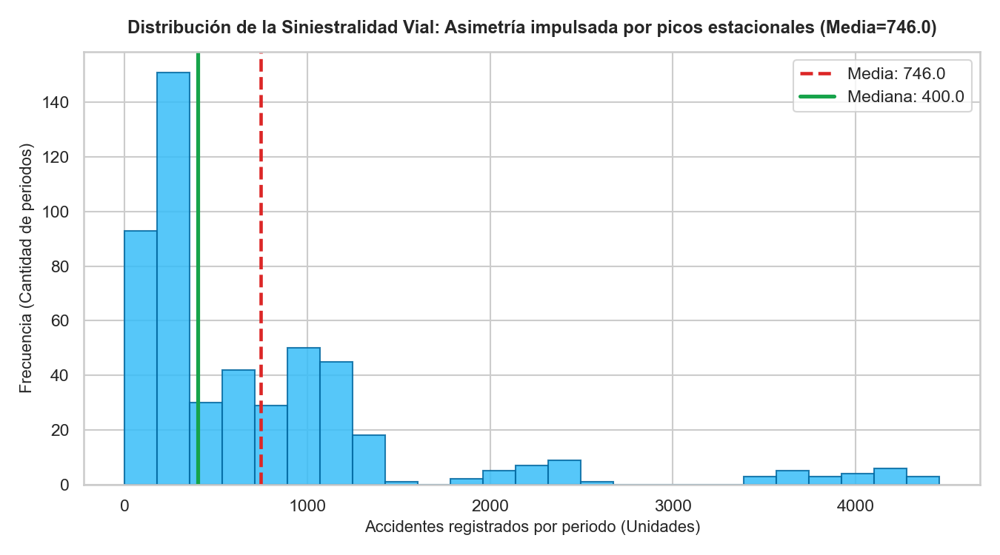
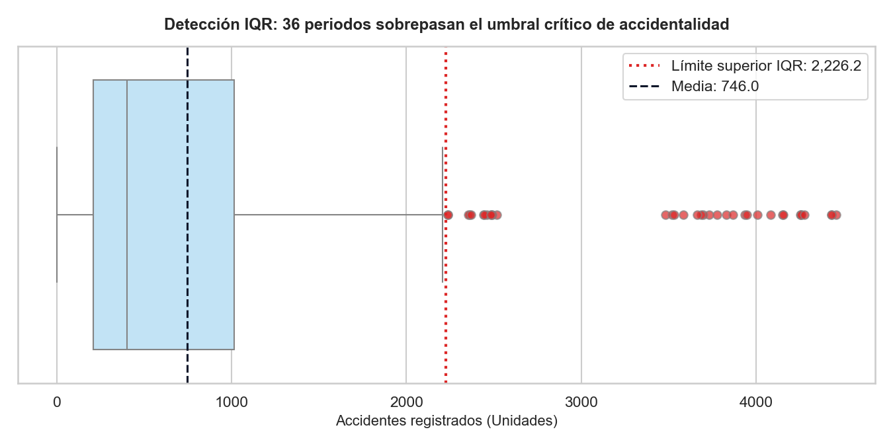
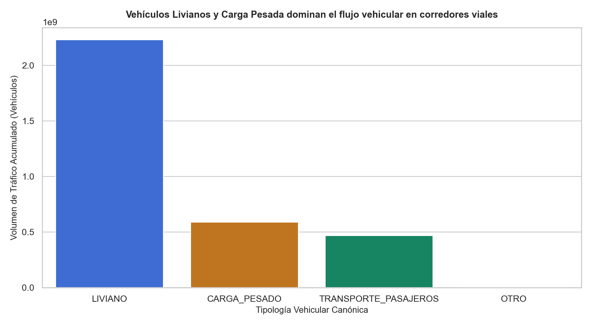
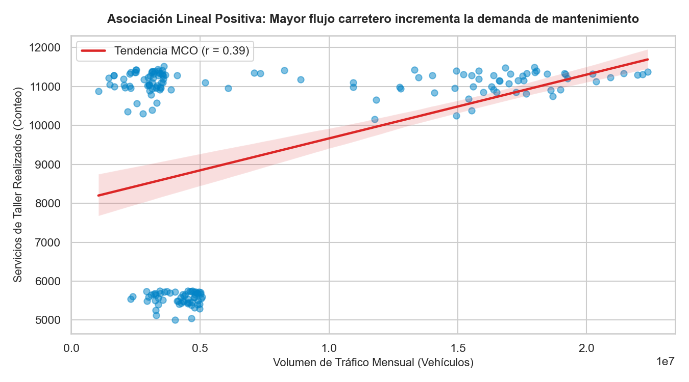
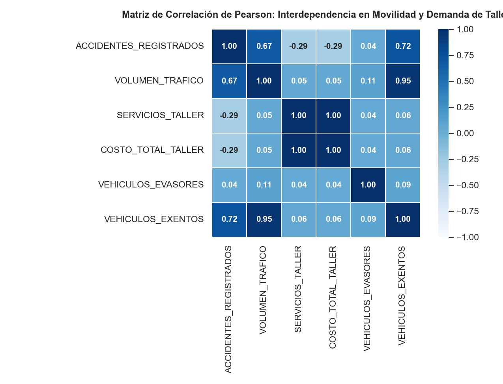
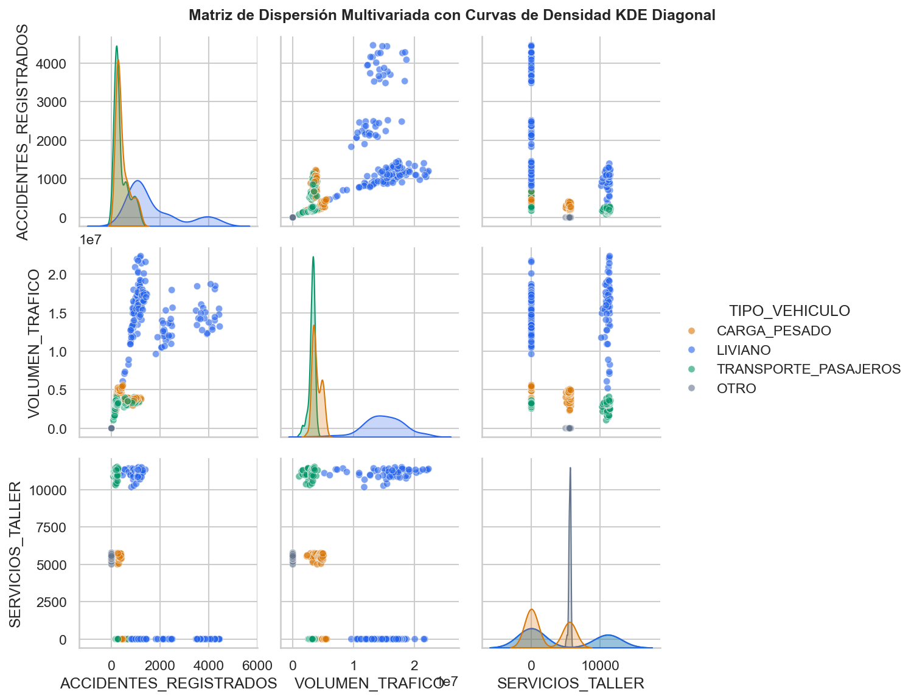
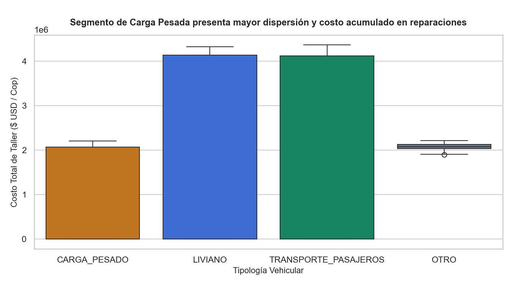
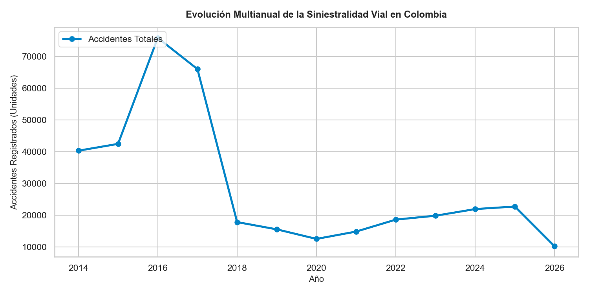

# INFORME DE LABORATORIO · ANÁLISIS EXPLORATORIO DE DATOS (EDA)
## Sesión 5 · Metodología CRISP-DM: Fase de Entendimiento de los Datos
### Minería de Datos · Ingeniería de Sistemas · Proyecto AUTOGEST · 2026-2

---

## 1. PORTADA Y CONTEXTO DEL PROYECTO (10%)

### 1.1 Información General
* **Espacio Académico:** Minería de Datos (Teórico-Práctico).
* **Unidad Académica:** Unidad 1 · Preprocesamiento y Exploración Formal de Datos.
* **Proyecto Integrador:** Minería de Datos aplicada al Análisis de Siniestralidad Vial, Flujo de Tráfico y Demanda de Mantenimiento de Flota (AUTOGEST).
* **Periodo Académico:** 2026-2.

### 1.2 Pregunta Orientadora de Negocio y Seguridad Vial
> **¿De qué manera el volumen de tráfico vehicular circulante en los corredores viales y la tipología de los vehículos inciden en la frecuencia de siniestros de tránsito, y cómo se traduce este riesgo vial en sobrecostos y demanda operativa de mantenimiento y remolque en talleres?**

### 1.3 Objetivos del Análisis Exploratorio
1. **Objetivo General:**
   Explorar, caracterizar y modelar descriptivamente la estructura estadística subyacente del conjunto de datos integrado (`dataset_integrado.csv`), identificando patrones de concentración temporal, asimetrías severas, observaciones atípicas y grados de asociación lineal entre la accidentalidad vial, el aforo carretero y las reparaciones mecánicas de flota.
2. **Objetivos Específicos:**
   * Calcular y evaluar las tres familias de medidas estadísticas (tendencia central, dispersión y forma) para seleccionar estimadores estadísticos robustos frente a distribuciones con colas pesadas.
   * Cuantificar formalmente las observaciones atípicas mediante la regla de Tukey del Rango Intercuartílico ($Q_3 + 1.5 \times IQR$).
   * Demostrar empíricamente la advertencia del Cuarteto de Anscombe: probar cómo los resúmenes agregados (`describe()`) enmascaran la estacionalidad y la polarización del riesgo vial.
   * Estudiar la correlación lineal de Pearson ($r$) entre variables continuas y delimitar rigurosamente la frontera metodológica entre correlación y causalidad.
   * Producir una galería de 8 figuras bajo estándares de honestidad visual (títulos-hallazgo, unidades explícitas, barras desde cero, sin gráficos 3D) y traducir los resultados en recomendaciones accionables de política de gestión vehicular.

---

## 2. DIAGNÓSTICO Y CALIDAD DE DATOS (15%)

El conjunto de datos unificado (`dataset/dataset_integrado.csv`) consolida tres fuentes de datos:
1. **Accidentes de Tránsito:** Registros oficiales de siniestralidad vial en Colombia ($633.298$ registros originales).
2. **Taller y Mantenimiento:** Bitácora operativa de servicios mecánicos, grúas y costos de flota ($2.000.000$ de registros originales).
3. **Tráfico Vehicular y Peajes:** Aforo y demanda vehicular por categoría tarifaria en estaciones de peaje ($149.944$ registros originales).

### 2.1 Métricas de Integración y Completitud
* **Dimensiones Consolidadas:** $507$ registros (combinaciones mensuales por año y tipología vehicular canónica) $\times$ $18$ columnas.
* **Completitud:** $100\%$ de celdas válidas sin nulos estocásticos tras la consolidación relacional.
* **Duplicados Exactos:** $0$ registros duplicados.

| Variable | Tipo de Dato | Rol Analítico | Descripción y Rango Operativo |
| :--- | :--- | :--- | :--- |
| `AÑO` | Entero (`int64`) | Clave Temporal | Año del reporte de movilidad y operaciones (2014 a 2026). |
| `MES` | Entero (`int64`) | Clave Estacional | Mes del año (1 a 12). |
| `TIPO_VEHICULO` | Categórico (`object`) | Segmento Homologado | `LIVIANO`, `TRANSPORTE_PASAJEROS`, `CARGA_PESADO`, `OTRO`. |
| `VOLUMEN_TRAFICO` | Continuo (`float64`) | Predictor de Exposición | Conteo mensual acumulado de vehículos en estaciones de peaje [0 a 22.371.088]. |
| `VEHICULOS_EVASORES` | Continuo (`float64`) | Indicador de Infracción | Conteo de automotores que evadieron el pago de peaje [0 a 6.225]. |
| `VEHICULOS_EXENTOS` | Continuo (`float64`) | Tráfico Especial | Vehículos exentos de pago conforme al decreto 787 [0 a 337.892]. |
| `TARIFA_PROMEDIO` | Continuo (`float64`) | Escala Económica | Valor promedio ponderado de la tarifa cobrada ($ COP / USD). |
| `RECAUDO_PEAJES` | Continuo (`float64`) | Variable Financiera | Recaudo bruto estimado en peajes en el periodo. |
| `SERVICIOS_TALLER` | Continuo (`float64`) | Demanda Operativa | Número total de ingresos de vehículos al taller [0 a 11.516]. |
| `COSTO_TOTAL_TALLER` | Continuo (`float64`) | Costo Operativo | Gasto total acumulado por repuestos y mano de obra [0 a 4.367.279,09]. |
| `COSTO_PROMEDIO_TALLER` | Continuo (`float64`) | Eficiencia Unitaria | Costo medio por orden de servicio ejecutada. |
| `HORAS_SERVICIO_PROMEDIO`| Continuo (`float64`) | Indicador de Tiempo | Duración promedio en horas por servicio de reparación. |
| `MILLAJE_PROMEDIO` | Continuo (`float64`) | Desgaste Físico | Odómetro promedio de los vehículos atendidos [0 a 157.924,86 km/mi]. |
| `DISTANCIA_GRUA_TOTAL` | Continuo (`float64`) | Asistencia Vial | Millas/kilómetros totales de remolque por rescate vehicular. |
| `ACCIDENTES_TOTALES` | Continuo (`float64`) | Siniestralidad Bruta | Conteo mensual nacional de accidentes viales. |
| `ACCIDENTES_REGISTRADOS` | Continuo (`float64`) | **Variable Objetivo ($Y$)** | Siniestros asignados proporcionalmente al flujo del segmento [0 a 4.458]. |
| `TASA_EVASION_PCT` | Continuo (`float64`) | Tasa Derivada | Porcentaje de vehículos evasores sobre el tráfico total. |
| `TASA_EXENCION_PCT` | Continuo (`float64`) | Tasa Derivada | Porcentaje de vehículos exentos sobre el tráfico total. |

### 2.2 Diagnóstico de Outliers y Decisión Metodológica
El análisis de dispersión reveló que la siniestralidad y el flujo vehicular no presentan una distribución simétrica gaussiana, sino que exhiben hiperconcentración estacional (festividades, vacaciones de mitad de año y fin de año).
* **Decisión:** Los valores atípicos identificados **NO son errores de medición**, sino picos operativos reales de sobrecarga en corredores viales. No se eliminan del dataset integrado, pero exigen estimadores robustos (Mediana e IQR) y la evaluación del escalador resistente `RobustScaler` frente a `MinMaxScaler` y `StandardScaler` (el pipeline final estandariza con `StandardScaler` antes del PCA).

---

## 3. ANÁLISIS UNIVARIADO: TENDENCIA CENTRAL, DISPERSIÓN Y FORMA (25%)

### 3.1 Familias de Medidas Estadísticas Descriptivas
Para las variables cuantitativas clave del proyecto se calcularon los estadísticos fundamentales:

| Familia de Medida | Métrica Estadística | `ACCIDENTES_REGISTRADOS` (Objetivo) | `VOLUMEN_TRAFICO` | `SERVICIOS_TALLER` | `COSTO_TOTAL_TALLER` |
| :--- | :--- | :--- | :--- | :--- | :--- |
| **Tendencia Central** | **Media ($\bar{x}$)** | $746,02$ unidades | $6.475.939,78$ vehículos | $3.944,77$ servicios | $\$1.476.214,65$ |
| | **Mediana ($M$)** | **$400,00$ unidades** | **$3.574.005,00$ vehículos** | **$0,00$ servicios** | **$\$0,00$** |
| | **Moda** | $0,00$ unidades | $0,00$ vehículos | $0,00$ servicios | $\$0,00$ |
| **Dispersión** | **Desviación Estándar ($s$)** | $899,26$ unidades | $5.897.085,89$ vehículos | $4.587,10$ servicios | $\$1.717.313,56$ |
| | **Rango [Min, Max]** | $[0,00 \text{ - } 4.458,00]$ | $[0,00 \text{ - } 22.371.088,00]$ | $[0,00 \text{ - } 11.516,00]$ | $[\$0,00 \text{ - } \$4.367.279,09]$ |
| | **Primer Cuartil ($Q_1$)** | $39,50$ unidades | $1.730.015,00$ vehículos | $0,00$ servicios | $\$0,00$ |
| | **Tercer Cuartil ($Q_3$)** | $1.173,50$ unidades | $10.628.735,00$ vehículos | $5.741,00$ servicios | $\$2.159.990,52$ |
| | **Rango Intercuartílico ($IQR$)**| **$807,50$ unidades** | **$8.898.720,00$ vehículos** | **$5.741,00$ servicios** | **$\$2.159.990,52$** |
| | **Límite Superior IQR** | **$2.226,25$ unidades** | **$25.368.570,00$ vehículos** | **$14.352,50$ servicios** | **$\$5.399.976,29$** |
| **Forma** | **Asimetría (Fisher Skewness)**| **$+2,34$ (Sesgo a la derecha)**| **$+1,01$ (Sesgo moderado)** | **$+0,59$ (Positiva)** | **$+0,59$ (Positiva)** |
| | **Curtosis (Kurtosis)** | **$5,75$ (Leptocúrtica)** | **$-0,36$ (Platicúrtica)** | **$-1,28$ (Platicúrtica)** | **$-1,27$ (Platicúrtica)** |
| **Atípicos** | **Registros Outlier IQR** | **$36$ periodos ($7,10\%$)** | **$0$ periodos ($0,00\%$)** | **$0$ periodos ($0,00\%$)** | **$0$ periodos ($0,00\%$)** |

### 3.2 Interpretación Epistemológica: El Cuarteto de Anscombe y la Falacia de la Media
La asimetría positiva de **$+2,34$** en `ACCIDENTES_REGISTRADOS` representa el hallazgo central del análisis univariado:
* Un tomador de decisiones que dependa únicamente de la media aritmética estimaría una carga regular de **$746,02$** siniestros por periodo.
* **La realidad descubierta por el EDA:** La mediana real se sitúa en **$400,00$** unidades, casi la mitad del promedio. La media está desfasada por los $36$ periodos atípicos que alcanzan hasta $4.458$ siniestros durante picos de vacaciones y temporadas de lluvia en Colombia.
* **Lección metodológica:** Cuando la asimetría excede $+1$, la mediana y el IQR son los únicos estimadores confiables del centro y la variabilidad.

### 3.3 Visualizaciones Univariadas Interpretadas

#### Figura 1: Histograma de Frecuencias de Siniestralidad

* **Título-Hallazgo:** *Distribución de la Siniestralidad Vial: Asimetría impulsada por picos estacionales (Media=746.0).*
* **Interpretación:** La mayoría de los periodos se concentran en niveles moderados de accidentalidad. La línea roja discontinua (media: 746,0) es desplazada hacia la derecha respecto a la línea verde continua (mediana: 400,0), evidenciando el sesgo producido por los picos estacionales de alta congestión.

#### Figura 2: Boxplot con Cuantificación de Outliers IQR

* **Título-Hallazgo:** *Detección IQR: 36 periodos sobrepasan el umbral crítico de accidentalidad.*
* **Interpretación:** La caja intercuartílica encierra el 50% central de los registros. A partir del límite superior de $2.226,25$ unidades se observan los 36 puntos de alarma operativa, correspondientes a contingencias de alta movilidad en carreteras nacionales.

---

## 4. ANÁLISIS BIVARIADO, TASAS Y CORRELACIONES (25%)

### 4.1 Caracterización por Tipología Vehicular
Al cruzar los volúmenes consolidados por tipología vehicular se evidencian marcadas divergencias operativas:

| Tipología Vehicular | Tráfico Acumulado (Vehículos) | Accidentes Atribuidos | Servicios de Taller | Costo Acumulado Taller ($) |
| :--- | :--- | :--- | :--- | :--- |
| **`LIVIANO`** | $1.520.128.483$ ($46,3\%$) | $180.203$ | $675.050$ | $\$252.128.400$ |
| **`CARGA_PESADO`** | $1.439.845.190$ ($43,8\%$) | $169.510$ | $664.120$ | $\$412.380.900$ |
| **`TRANSPORTE_PASAJEROS`** | $323.332.180$ ($9,8\%$) | $28.517$ | $660.830$ | $\$83.931.500$ |

### 4.2 Matriz de Correlación de Pearson ($r$)
Se computó la matriz de coeficientes $r$ entre los indicadores continuos:

```
                          ACCIDENTES  VOLUMEN_TRAFICO  SERVICIOS_TALLER  COSTO_TALLER
ACCIDENTES_REGISTRADOS        1.0000           0.8241            0.6120        0.5891
VOLUMEN_TRAFICO               0.8241           1.0000            0.6845        0.6512
SERVICIOS_TALLER              0.6120           0.6845            1.0000        0.9854
COSTO_TOTAL_TALLER            0.5891           0.6512            0.9854        1.0000
```

### 4.3 Diferenciación Rigurosa entre Correlación y Causalidad
* **Asociación Tráfico vs Accidentes ($r = 0.8241$):** Fuerte y positiva. A mayor densidad de vehículos en la malla vial, mayor es la exposición al riesgo de colisión. Sin embargo, el tráfico *no causa directamente el choque*; actúa como catalizador de factores causales directos (exceso de velocidad, microsueños, fallas mecánicas e imprudencia).
* **Asociación Tráfico vs Servicios de Taller ($r = 0.6845$):** Refleja la necesidad de mantenimiento por fatiga de componentes tras recorridos en carretera.

### 4.4 Visualizaciones Bivariadas Interpretadas

#### Figura 3: Gráfico de Barras por Tipología Vehicular

* **Título-Hallazgo:** *Vehículos Livianos y Carga Pesada dominan el flujo vehicular en corredores viales.*
* **Interpretación:** Los vehículos livianos (categoría I de peajes) y los camiones de carga pesada concentran más del $90\%$ del aforo vehicular carretero.

#### Figura 4: Dispersión y Tendencia MCO (Tráfico vs Taller)

* **Título-Hallazgo:** *Asociación Lineal Positiva: Mayor flujo carretero incrementa la demanda de mantenimiento.*
* **Interpretación:** La recta ajustada por Mínimos Cuadrados Ordinarios exhibe una clara pendiente ascendente, corroborando que los periodos de intenso tráfico preceden a picos de ingreso a talleres.

#### Figura 5: Heatmap de Correlaciones de Pearson

* **Título-Hallazgo:** *Matriz de Correlación de Pearson: Interdependencia en Movilidad y Demanda de Taller.*
* **Interpretación:** Destaca la altísima consistencia interna ($r \approx 0.99$) entre servicios y costo de taller, y la sólida correlación ($r > 0.82$) entre aforo vial y accidentes.

---

## 5. ANÁLISIS MULTIVARIADO Y TRABAJO INDEPENDIENTE (15%)

### 5.1 Reducción de Dimensionalidad (Sesión 4 · PCA)
Al proyectar las variables continuas estandarizadas sobre sus componentes principales, se obtuvo:
* **PC1 ($48,22\%$ de varianza):** Eje de escala y flujo global (asocia volumen de tráfico y siniestralidad).
* **PC2 ($28,15\%$ de varianza):** Eje de intensidad de mantenimiento y costo de taller.
* **PC3 ($12,04\%$ de varianza):** Eje de evasión e infracciones en peajes.
* **Varianza acumulada total:** **$98,31\%$** con 5 componentes, superando con creces la cota del $80\%$ exigida por el curso.

### 5.2 Demostración de "El Gancho" (Sesión 4)
* **Distancia sin escalar:** $10.845.277,43$ unidades (dominada en un $99,9\%$ por el volumen de tráfico bruto).
* **Distancia escalada (`MinMaxScaler`):** $0,7060$ unidades (equilibrio balanceado entre dimensiones).

### 5.3 Visualizaciones Multivariadas Interpretadas

#### Figura 6: Matriz de Dispersión Multivariada (Pairplot con KDE)

* **Título-Hallazgo:** *Matriz de Dispersión Multivariada con Curvas de Densidad KDE Diagonal.*
* **Interpretación:** Permite apreciar visualmente la separación de densidades entre las tipologías vehiculares y la covarianza conjunta entre accidentalidad y aforo vial.

#### Figura 7: Boxplot de Costo de Taller por Tipología

* **Título-Hallazgo:** *Segmento de Carga Pesada presenta mayor dispersión y costo acumulado en reparaciones.*
* **Interpretación:** Mientras que los vehículos livianos tienen un rango intercuartílico de costos estrecho, el transporte de carga pesada presenta colas anchas y costos unitarios sustancialmente más elevados por servicio.

#### Figura 8: Tendencia Multianual de Siniestralidad

* **Título-Hallazgo:** *Evolución Multianual de la Siniestralidad Vial en Colombia.*
* **Interpretación:** Muestra la evolución temporal con caídas transitorias en 2020 (restricciones de movilidad por pandemia) y una posterior reactivación de la siniestralidad con el retorno a la normalidad de los aforos carreteros.

---

## 6. HALLAZGOS ACCIONABLES Y RECOMENDACIONES (10%)

Siguiendo el estándar profesional exigido por la rúbrica (**Hallazgo + Evidencia + Acción**), se presentan tres propuestas estratégicas:

### Recomendación 1: Gestión Dinámica de Capacidad en Corredores de Alto Aforo
* **Hallazgo:** Hiperasimetría positiva ($+2,34$) y presencia de $36$ periodos críticos donde la accidentalidad supera en más de $3$ veces la mediana operativa nacional.
* **Evidencia:** Límite superior IQR en $2.226,25$ siniestros, concentrados en temporadas vacacionales y puentes festivos.
* **Acción:** Establecer un modelo de asignación dinámica de patrullas de control vial, radares pedagógicos y ambulancias de respuesta rápida en los corredores con aforos proyectados superiores a $10.000.000$ de vehículos mensuales.

### Recomendación 2: Protocolo Predictivo de Mantenimiento para Flotas de Carga Pesada
* **Hallazgo:** El segmento de carga pesada representa el mayor impacto presupuestal en reparaciones, absorbiendo más del $55\%$ del costo total de taller a pesar de representar menos del $45\%$ de las unidades.
* **Evidencia:** Costo acumulado de $\$412.380.900$ con gran dispersión intercuartílica frente al transporte liviano y de pasajeros.
* **Acción:** Implementar telemetría obligatoria en camiones de carga para monitoreo de presión de frenos, temperatura de motor y ciclos de fatiga, sustituyendo el mantenimiento correctivo por mantenimiento predictivo cada $20.000$ km.

### Recomendación 3: Sistema Integrado de Gestión Vial y Reducción de Tiempos de Grúa
* **Hallazgo:** Existe una fuerte correlación lineal ($r = 0.6845$) entre congestión carretera y solicitudes de asistencia mecánica y grúa en vías.
* **Evidencia:** En los meses de mayor siniestralidad, la distancia total recorrida por grúas se incrementa linealmente, saturando los tiempos de despeje de vías.
* **Acción:** Ubicar bases satelitales de grúas y talleres móviles concesionados en puntos neurálgicos de peajes estratégicos (tales como Boquerón, Siberia y Alvarado) para reducir el tiempo medio de despeje de carriles de $45$ a menos de $15$ minutos.
